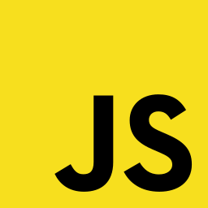
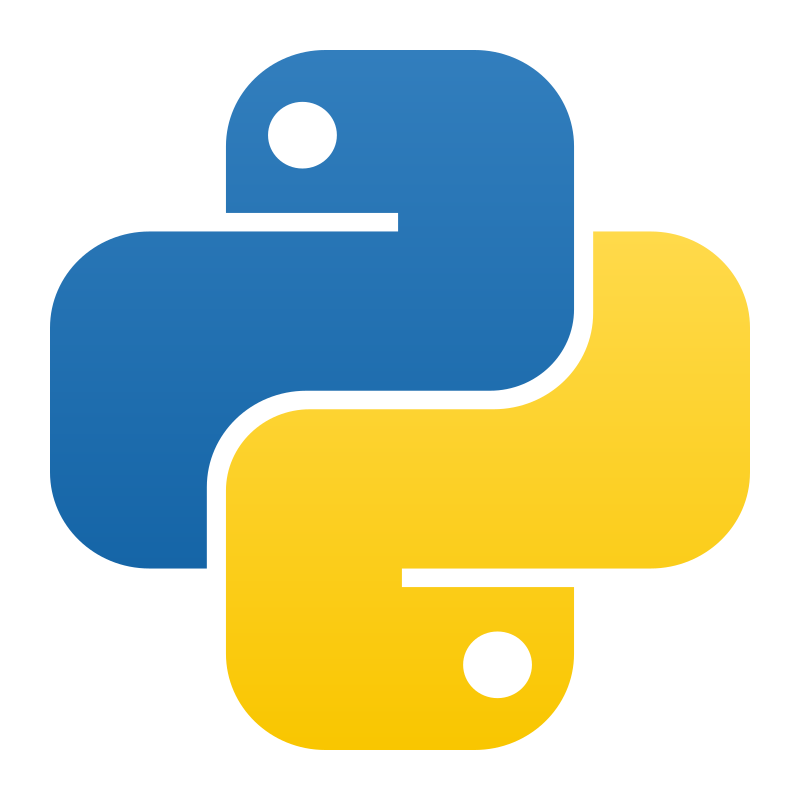
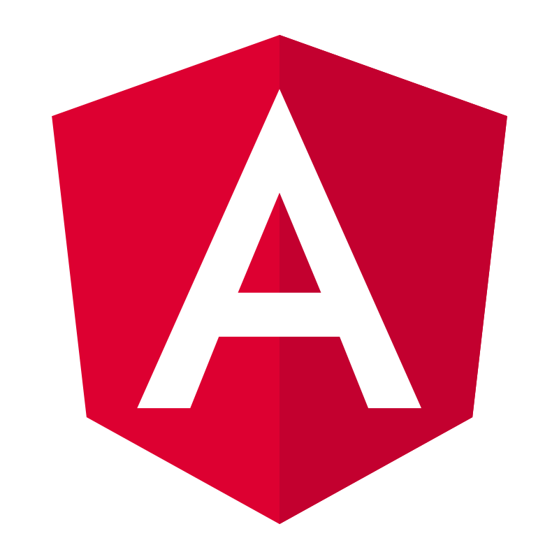
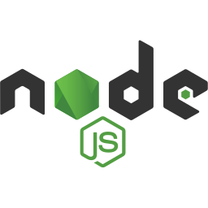
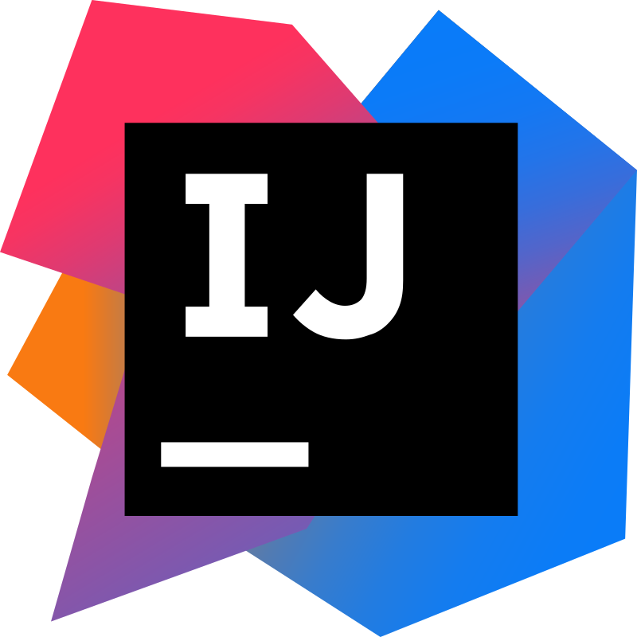
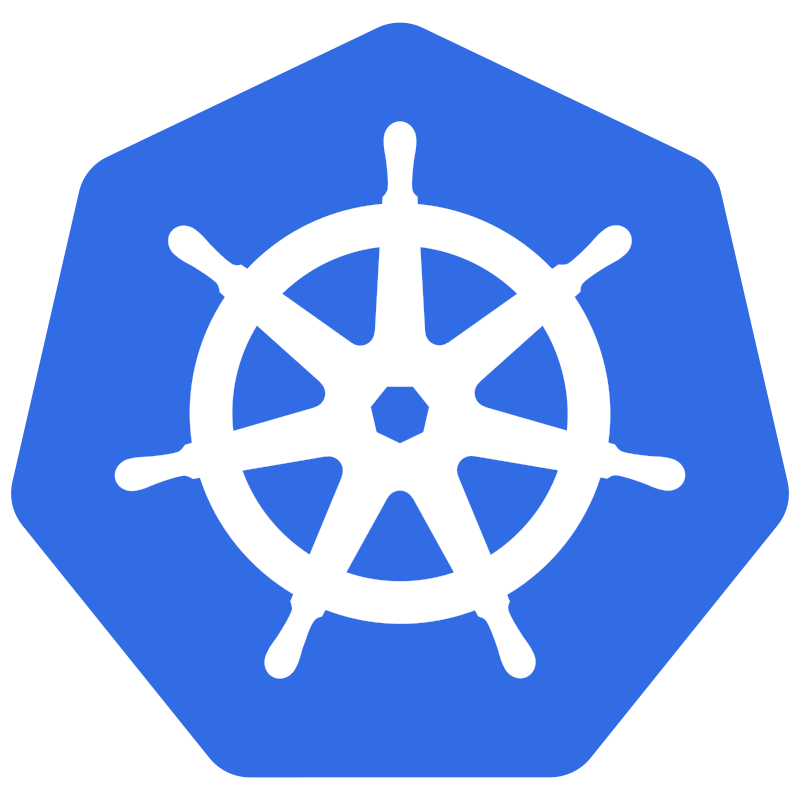
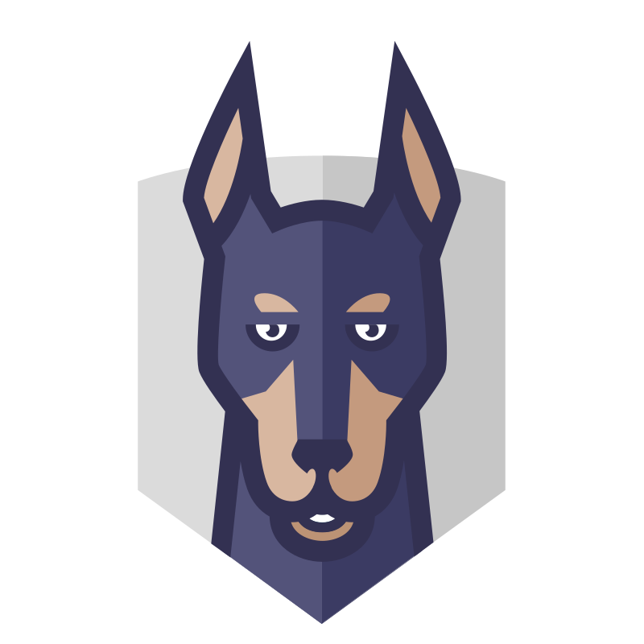

<h1 align="center">
    
</h1>

  
  
  
  

  

---

<h2 align="center">👋 About Me</h2>

🏡 Based in Pune, Maharashtra  
💼 Solution Architect at Western Union  
🏗️ Solution Architect with hands-on experience building enterprise applications using Java, Spring Boot, microservices, and Angular  
⚙️ Focused on scalable system design, event-driven architectures, cloud-native engineering, and reliable software delivery  

---

<h2 align="center">🚀️ Tech Stack Overview</h2>

### 💻 Programming Languages

    
    &nbsp;
    
    &nbsp;
    
    &nbsp;
    
    &nbsp;
    
    &nbsp;
    
    &nbsp;
    

### 🧱 Frameworks & Libraries

    
    &nbsp;
    
    &nbsp;
    

### 🛠 Tools, Platforms & Services

    
    &nbsp;
    
    &nbsp;
    
    &nbsp;
    
    &nbsp;
    
    &nbsp;
    
    &nbsp;
    
    &nbsp;
    
    &nbsp;
    
    &nbsp;
    
    &nbsp;
    
    &nbsp;
    
    &nbsp;
    
    &nbsp;
    
    &nbsp;
    
    &nbsp;
    
    &nbsp;
    

---

<h2 align="center">📝 Currently Exploring</h2>

I'm exploring how AI capabilities can be integrated into Java applications, focusing on **Spring AI, Retrieval-Augmented Generation (RAG), and agentic AI workflows**.

I'm interested in practical AI integrations, including connecting LLMs with Java services, building context-aware applications, and leveraging **Claude Skills** to enhance developer workflows.

Alongside this, I continue to strengthen my software engineering fundamentals and document useful technical insights through code examples, articles, and personal projects.

---

<h2 align="center">💼 Career Journey</h2>

I'm a **Solution Architect and hands-on Java engineer** with around 9 years of experience building and evolving enterprise applications across the **finance, healthcare, and insurance domains**. My experience spans backend engineering, full-stack development, solution design, and technical leadership.

I currently work at Western Union, leading technical design and delivery across enterprise fraud and compliance applications. My core technology stack includes **Java, Spring Boot, microservices, Kafka, REST APIs, Angular, and Kubernetes**.

Previously, I worked at **Wipro, Cognizant, and Capgemini**, contributing to enterprise applications, backend integrations, event-driven systems, and automation. My experience covers the software development lifecycle, from requirements analysis and architecture to development, testing, and deployment.

I'm passionate about **scalable system design, distributed systems, clean architecture, production reliability, and engineering best practices**. I enjoy solving practical technical challenges, mentoring engineers, and continuously learning through hands-on experimentation.

---

<h2 align="center">🤝 Connect with Me</h2>

    

---
